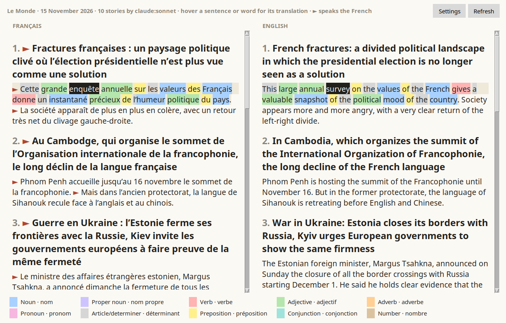

# French News Reader

Learn French by reading the day's news. The app shows the top 10 stories from
Le Monde as short summaries, French on the left and English on the right, and
links the two languages sentence by sentence and word by word. Any other web
page can be read the same way.



## Download and install

Get the file for your computer from the
[Releases page](../../releases/latest). No Python or other setup is needed.

- **Windows:** run `french-news-reader-windows-setup.exe`. Windows may say
  "Windows protected your PC" because the app is not signed with a paid
  certificate: click **More info**, then **Run anyway**.
- **Mac:** unzip and drag **French News Reader** into Applications. The first
  time, macOS will refuse to open it: open **System Settings > Privacy &
  Security** and click **Open Anyway**. Use the `apple-silicon` file for Macs
  from 2020 onward, `intel` for older ones.
- **Linux:** unpack the `.tar.gz` and run `./install.sh` inside it. This adds
  the app to your menu and a `french-news-reader` command. `./install.sh
  --uninstall` removes it.

On first launch the app asks you to choose an AI service and paste an API key
from it. The service bills you for what you use; a day's news typically costs
a few cents.

## Privacy and security

- Your API key is stored as plain text in the app's settings file on your own
  computer and is sent only to the AI service you chose.
- The news text, and the text of any web page you load, is sent to that AI
  service. Web pages are fetched directly from your computer.
- The app has no accounts, analytics or telemetry.
- The downloads are built by GitHub from this repository's source
  (`.github/workflows/release.yml`). They are not code-signed.

## Run from source

For people comfortable with Python (3.10 or later, with Tkinter):

```bash
git clone https://github.com/rsampson/foreign-language-news-reader.git
cd foreign-language-news-reader
python3 -m venv .venv
.venv/bin/pip install -r requirements.txt
.venv/bin/python -m piper.download_voices --data-dir voices fr_FR-siwis-medium
.venv/bin/python news_reader.py
```

On Windows use `.venv\Scripts\python` in place of `.venv/bin/python`. The
packages are optional: without them the app still runs with plain `python3
news_reader.py`, minus the French voice and the Claude API-key option.
`python news_reader.py --self-test` checks that everything is in place.

The first launch of the day fetches and summarises the news, which takes a few
minutes. After that the day's stories are saved, so reopening is instant.

## Reading

| Do this | What happens |
|---|---|
| Move the mouse over a sentence | That sentence and its translation in the other panel are highlighted. The other panel scrolls if needed. |
| Look at the highlighted sentence | Each word is coloured by its part of speech. The key at the bottom of the window explains the colours. |
| Move the mouse over a word | The word and the word or words that translate it turn into dark boxes. A word with no counterpart highlights on its own side only. |
| Click the red ► before a French sentence | The sentence is read aloud in French. Clicking another ► interrupts it. |
| Click **Refresh** | The news, or the web page on screen, is fetched again, replacing today's saved copy. |

Everything works from either panel: you can hover the English to find the
French, or the other way round.

## Reading any web page

The app opens on the news. To read something else, paste a web address into
the **Web page** box and press Enter or click **Read this page**. Click
**Back to Le Monde news** to return to the news.

- The page can be in any language. The AI divides it into up to 10 sections,
  each with a French headline, a short French summary and its English
  translation.
- It is a summary, not the whole page: only the first 12,000 characters of the
  page's readable text are used, so long pages are covered from the top.
- Clutter is filtered out before the AI sees the page: menus, headers and
  footers, and anything the page labels as an advert, sponsored content, a
  cookie notice, a newsletter sign-up, a pop-up or a "related stories" box.
  Scripts are never run, so adverts inserted by scripts never load at all.
  Promotional text written as ordinary paragraphs can still slip through.
- Pages that need a login, or that build their content with JavaScript, give a
  "No readable text found" message. PDFs and other files are not supported.
- Each page is saved for the day, so loading the same address again is instant.

## Choosing the AI (Settings)

Click **Settings** to choose which AI writes the summaries and translations.

- **Claude, with an Anthropic API key.** Paste a key from
  platform.claude.com. Uses Claude Opus by default; supports every feature.
- **OpenAI-compatible service, with an API key.** Covers OpenAI, Google
  Gemini, Mistral, Groq, OpenRouter and others. Enter the service's address
  and your key, click **List models** and pick one.
- **Ollama** uses a model running on your own computer. Free and offline, but
  slow without a graphics card (around 10 minutes for ten stories).
- **Claude Code command-line tool**, for people who have it installed. It uses
  a Claude subscription instead of an API key.

**Word detail** controls the part-of-speech colours and word-to-word matching.
Turn it off for an AI that is too slow or unreliable to produce them. If an AI
returns no word information, the colour key and word highlighting disappear on
their own; sentence highlighting, translation and speech keep working.

"Save and refresh now" fetches the news immediately with the new AI. "Save"
waits until you next click Refresh. The status bar at the top shows which AI
wrote the stories on screen.

API keys are stored in plain text in the settings file, readable only by your
user account.

## Things to know

- Summaries are written from Le Monde's headline and short blurb only, not the
  full article, so they are brief.
- The translations, part-of-speech tags and word matches come from the AI. They
  are usually right, but an occasional one will be debatable.
- Speech takes about a second to start, because the audio is generated when you
  click.

## Files

| Path | Purpose |
|---|---|
| `news_reader.py` | The whole app. |
| `settings.json` | Your AI choice, created when you first save Settings. |
| `cache/` | Saved stories: one file per day for the news and one per web page per day. Safe to delete. |
| `.venv/` | Piper, the program that produces the French voice. |
| `voices/` | The French voice model (`fr_FR-siwis-medium`, about 63 MB). |

In the downloaded app, settings and the cache live in your user data folder
instead (`%APPDATA%\french-news-reader`, `~/Library/Application
Support/french-news-reader` or `~/.local/share/french-news-reader`).

## Changing things

The constants at the top of `news_reader.py` control:

- `FEED_URL` and `FEED_NAME`: the news source (any RSS feed in French).
- `ITEM_COUNT`: how many stories to show, and the most sections made from a
  web page.
- `MAX_PAGE_CHARS`: how much of a web page's text is given to the AI.
- `PIPER_VOICE` and `PIPER_LENGTH_SCALE`: the voice and its speed (above 1 is
  slower).
- `PARTS_OF_SPEECH`: the colours and labels in the key.

## Licence and credits

French News Reader is free software under the [GNU GPL v3](LICENSE), with no
warranty. The downloadable apps include [Piper](https://github.com/OHF-voice/piper1-gpl)
(GPL-3.0) and the `fr_FR-siwis-medium` voice, trained on the SIWIS French
speech dataset (CC BY 4.0). News summaries are generated from Le Monde's
public RSS feed; this project is not affiliated with Le Monde.
